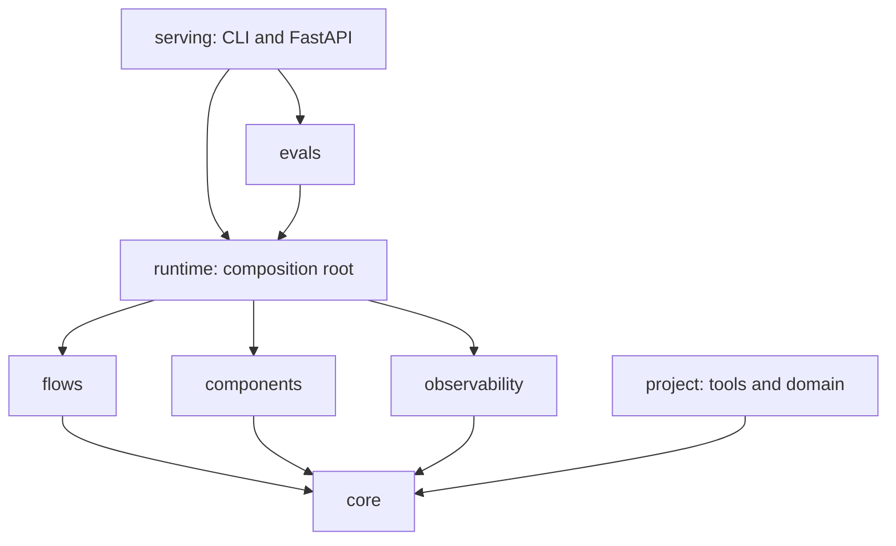
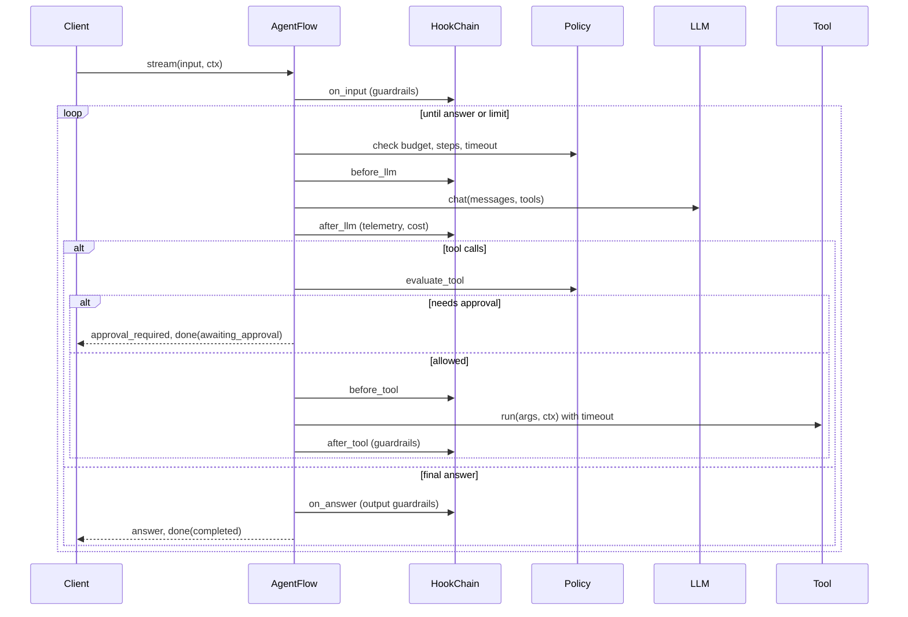

# Architecture

## Layers

| Package | Responsibility | May import |
|---|---|---|
| `aikit.core` | Types, interfaces (`ports.py`), registry, builder, config, policy, hooks | stdlib, pydantic, yaml |
| `aikit.components` | Adapters: LLMs, embedders, stores, loaders, chunkers, retrievers, rerankers, memory, tools, guardrails | `core` |
| `aikit.flows` | Ingest, RAG, and agent flows built only on interfaces | `core` |
| `aikit.observability` | Logging, tracing, cost accounting, the telemetry hook | `core` |
| `aikit.runtime` | Turns config into objects; the only place that knows every layer | all of the above |
| `aikit.evals` | Dataset runner and metrics | `runtime`, `core` |
| `aikit.serving` | CLI and HTTP API | everything |

`.importlinter` enforces these rules in CI. The two that matter most are:

- **`core` imports no I/O libraries and no AI SDKs.** Interfaces stay stable when vendors change.
- **Components and flows never import each other.** A flow works with any retriever, and a retriever works in any flow.

## How config becomes objects

1. `load_config` reads YAML, resolves `extends`, applies `--set` overrides, swaps in fakes when offline, interpolates `${ENV:-default}`, and validates the result against `AppConfig`.
2. `runtime.load_runtime` imports built-in components and flows (registering them), imports `imports:` modules, and loads allowlisted `plugins:`.
3. `Builder` builds components lazily. Each spec's `type` is looked up in the registry for the expected kind. `"@name"` strings become references to other components, with cycle detection. Parameters are validated against a pydantic model generated from the constructor signature, so typos and wrong types fail at startup with the config path in the message.
4. Nested specs are built automatically because the builder reads constructor annotations. A parameter typed `list[Tool]` turns `- check_refund_eligibility` into a built tool.
5. The runtime attaches the `TelemetryHook` to the flow and returns a `Runtime`.

## Request lifecycle (agent flow)

Every flow emits the same `RunEvent` stream: `start`, `retrieval`, `token`, `tool_call`, `tool_result`, `approval_required`, `answer`, `error`, and `done`. The `done` event carries the full `RunResult`. The CLI, SSE API, and eval runner all consume this one stream.

## Safety model

- **The policy is not a hook.** Flows enforce step limits, token budgets, timeouts, tool allowlists, and denied capabilities directly, so no plugin can bypass them.
- **Tools declare capabilities** (`read`, `write`, `network`, `pii`, `code`). By default, `write` and `code` tools need human approval. Paused runs are stored in a `RunStore` and resumed with `resume(run_id, approvals)`. Tools run with the requester's identity, not the approver's.
- **ACL filtering happens in the store,** using `RunContext.groups`. A chunk with an `acl` list is only visible to callers who share a group with it. The default for an empty group list is public documents only.
- **Guardrails run at four stages:** `input`, `context` (retrieved chunks), `tool_result`, and `output`. If an output guardrail is configured, RAG buffers the answer instead of streaming tokens, so nothing unchecked reaches the user.
- **Business rules live in `project/domain/`,** not in prompts. Tools call domain functions, which enforce invariants for every caller.

## Extension points

| You want to | Do this |
|---|---|
| Add a tool | `@tool` function or `BaseTool` subclass in `project/tools/` |
| Use a different vector DB or model API | New component class with `@register(kind, name)`; add a contract test subclass |
| Share components across apps | Package them and expose entry points under `aikit.<kind>`; allowlist them under `plugins:` |
| Add cross-cutting behaviour (audit, caching, metrics) | Subclass `Hook` and register it as kind `hook`; list it under the flow's `hooks:` |
| Build a new workflow shape | Subclass `BaseFlow`, implement `_events`, and register it as kind `flow` |
